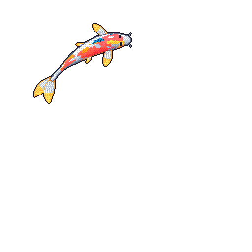

<div align="center">

<table>
<tr>
<td width="56%" valign="middle">

```text
● ● ●
────────────────────────────────────
██╗   ██╗ █████╗ ███╗   ██╗███████╗██╗  ██╗
██║   ██║██╔══██╗████╗  ██║██╔════╝██║  ██║
██║   ██║███████║██╔██╗ ██║███████╗███████║
╚██╗ ██╔╝██╔══██║██║╚██╗██║╚════██║██╔══██║
 ╚████╔╝ ██║  ██║██║ ╚████║███████║██║  ██║
  ╚═══╝  ╚═╝  ╚═╝╚═╝  ╚═══╝╚══════╝╚═╝  ╚═╝
```

</td>
<td width="22%" align="center" valign="middle">


</td>
<td width="22%" align="center" valign="middle">



</td>
</tr>
</table>

# VANSH KUMAR

`Developer` · `Student` · `Builder`

**Building things to understand how they work.**

[](https://github.com/solosurfer-37)
[](https://www.linkedin.com/in/vansh-kumar-042714377)
[](mailto:vanshk.0037@gmail.com)

</div>

## Currently

```text
DSA → Software Engineering → AI / ML

learning fundamentals.
building real projects.
figuring things out by building.
```

I'm currently focused on strengthening my DSA and software engineering fundamentals while moving deeper into AI/ML and LLM-based development.

I'm less interested in collecting technologies and more interested in understanding how things actually work, then using that knowledge to build something useful.

## Tech Stack

### Languages


### Development


### Data & Backend


### Tools


### Currently Exploring

`AI / ML` · `LLMs` · `FastAPI` · `PyTorch`

## GitHub Activity

<div align="center">


</div>

## Connect

<div align="center">

[](https://github.com/solosurfer-37)
[](https://www.linkedin.com/in/vansh-kumar-042714377)
[](mailto:vanshk.0037@gmail.com)
[](https://www.instagram.com/vxnshk.037/)

</div>

<div align="center">

<div align="center">

<code>────────────────────────────────────</code><br />
<br />
<code>one more commit and then I'll sleep.</code><br />
<code>(narrator: he did not sleep.)</code><br />
<br />
<code>────────────────────────────────────</code>

</div>
</div>
